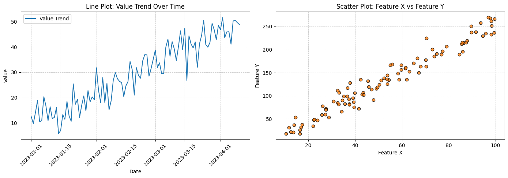
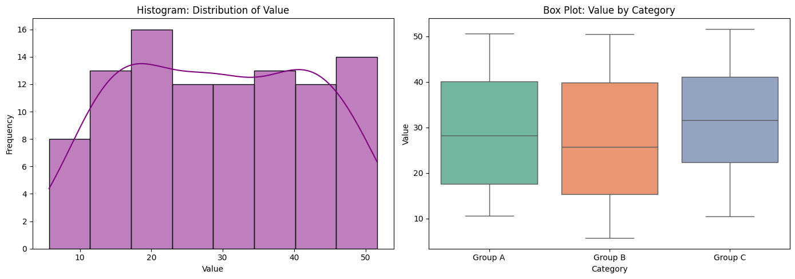

# FlexiSAF Data Science Internship Portfolio
### Modules 2 & 3: Exploratory Data Analysis, Statistical Modeling & Data Visualization

**Author:** Samuel Adebanjo  
**Role:** Data Science Intern at FlexiSAF Edusoft  
**Domain:** Applied Statistics, Data Analysis & Machine Learning  

---

## 📌 Executive Summary

This repository houses the end-to-end coursework and capstone analyses for **Module 2** and **Module 3** of the **FlexiSAF Data Science Internship Program**. 

The projects demonstrate core capabilities across the modern data science workflow:
1. **Module 2 — Exploratory Data Analysis & Statistical Modeling:** Statistical profiling, hypothesis formulation, ANOVA testing, correlation mapping, and regression/classification modeling on the classic Fisher's Iris dataset.
2. **Module 3 — Data Exploration & Visualization:** Visual storytelling and exploratory graphing using **Matplotlib** and **Seaborn**, covering distribution modeling, group comparisons, time trends, and multivariate scatter relationships.

---

## 📂 Repository Architecture

```text
Data_Science_Portfolio_2/
├── .gitignore                                                      # Git ignore configuration
├── requirements.txt                                                # Project dependencies
├── README.md                                                       # Master portfolio overview
│
├── Module_02_Exploratory_Data_Analysis/                            # Module 2 Project Folder
│   ├── README.md                                                   # Detailed Module 2 documentation
│   ├── iris_eda_and_statistical_modeling.ipynb                     # Interactive Jupyter Notebook
│   └── iris_eda_and_statistical_modeling.py                        # Executable Python script
│
├── Module_03_Data_Visualization/                                   # Module 3 Project Folder
│   ├── README.md                                                   # Detailed Module 3 documentation
│   ├── data_visualization_mastery.ipynb                            # Interactive visualization notebook
│   └── data_visualization_techniques.py                            # Executable Python visualization script
│
├── assets/
│   └── figures/                                                    # Exported visualization previews
│       ├── data_vis_fig1.png                                       # Line & scatter plots
│       └── data_vis_fig2.png                                       # Histogram & box plots
│
├── Data_Visualization.ipynb                                        # Original Module 3 submission file
└── Exploratory_Data_Analysis_&_Statistical_Modeling_of_the_Iris_Dataset.ipynb  # Original Module 2 submission file
```

---

## 🔬 Module Breakdown

### 📊 Module 2: Exploratory Data Analysis & Statistical Modeling

* **Dataset:** Fisher's Iris Dataset (150 samples, 4 continuous features, 3 species: *Setosa*, *Versicolor*, *Virginica*)
* **Core Objectives:**
  * **Summary Metrics:** Computed parametric (mean, variance, standard deviation) and non-parametric (median, mode, IQR) metrics across all features.
  * **Inter-Feature Association:** Generated Pearson correlation coefficients, identifying a significant positive correlation between petal length and petal width ($r = 0.963$).
  * **Hypothesis Testing (ANOVA):** Conducted One-Way Analysis of Variance across species groups, verifying that morphological trait variances are statistically significant ($p < 0.001$).
  * **Supervised Learning Models:**
    * *Linear Regression:* Quantified petal width as a function of petal length ($R^2 > 0.90$).
    * *Logistic Regression:* Implemented a multiclass species classifier to assess separability across morphological dimensions.

### 🎨 Module 3: Data Exploration & Visualization

* **Tooling:** Matplotlib (Pyplot) & Seaborn
* **Core Objectives:**
  * **Time-Series Analysis:** Illustrated dynamic changes and trends over continuous timeframes using styled line plots with gridlines and legends.
  * **Bivariate Correlation:** Mapped multi-feature interactions using color-mapped scatter plots.
  * **Distribution Analysis:** Characterized density and skewness using Kernel Density Estimation (KDE) and histograms.
  * **Group Comparisons:** Highlighted categorical quartiles and outliers via Seaborn box plots.

#### Visual Gallery

##### 1. Matplotlib: Line Trend & Correlation Scatter Plot


##### 2. Seaborn: Histogram Distribution & Categorical Box Plot


---

## 🛠️ Technology Stack

* **Language:** Python 3.10+
* **Data Manipulation & Profiling:** Pandas, NumPy
* **Scientific & Statistical Computing:** SciPy (Stats), Statsmodels
* **Machine Learning:** Scikit-Learn
* **Data Visualization:** Matplotlib, Seaborn
* **Interactive Environments:** Jupyter Notebook, Google Colaboratory

---

## 🚀 Setup & Execution Guide

### 1. Clone the Repository
```bash
git clone https://github.com/Oluola4002/Samuel_Adebanjo_DataScience_Portfolio_2.git
cd Samuel_Adebanjo_DataScience_Portfolio_2
```

### 2. Create and Activate Virtual Environment
```bash
# On Windows (PowerShell)
python -m venv venv
.\venv\Scripts\Activate.ps1

# On macOS/Linux
python3 -m venv venv
source venv/bin/activate
```

### 3. Install Dependencies
```bash
pip install -r requirements.txt
```

### 4. Run the Scripts or Launch Notebooks
```bash
# Run Module 2 script
python Module_02_Exploratory_Data_Analysis/iris_eda_and_statistical_modeling.py

# Run Module 3 script
python Module_03_Data_Visualization/data_visualization_techniques.py

# Or launch Jupyter
jupyter notebook
```

---

## 👨‍💻 Author & Acknowledgements

* **Author:** [Samuel Adebanjo](https://github.com/Oluola4002)
* **GitHub Profile:** [@Oluola4002](https://github.com/Oluola4002)
* **Email:** [samueloluola.a@gmail.com](mailto:samueloluola.a@gmail.com)
* **Organization:** [FlexiSAF Edusoft Ltd.](https://flexisaf.com/)
* **Internship Program:** FlexiSAF Data Science Internship
